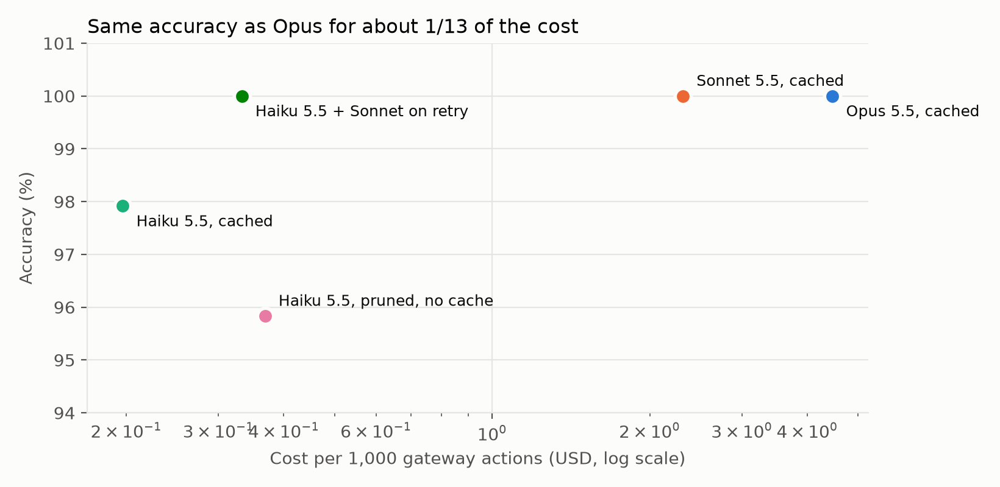
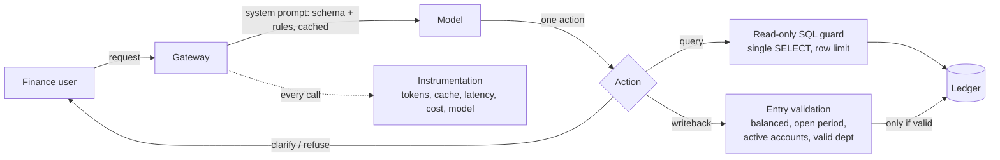
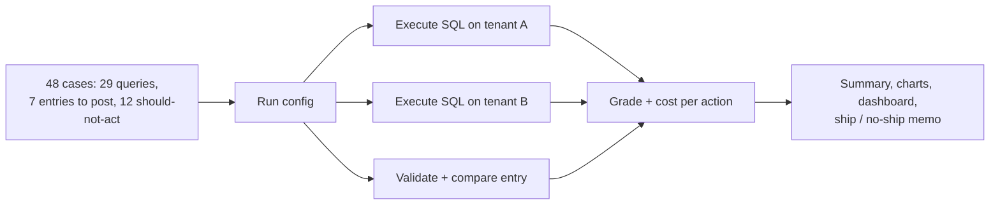
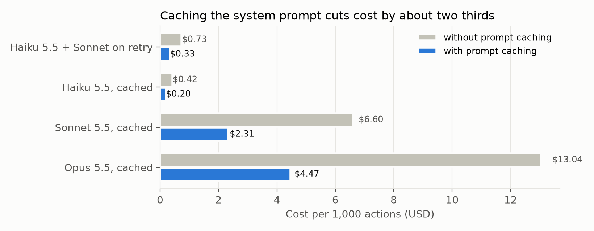

# finance-gateway-evals

**Evaluation and cost engineering for a natural-language gateway to an ERP general ledger.**

[](https://github.com/manishreddy998/finance-gateway-evals/actions/workflows/eval.yml)

Finance teams ask a gateway questions ("What was US01's net income in April?") and request journal entries
("Accrue $12,500 of legal fees for CA01 Admin in April"). A model turns each request into one action; a
governed gateway executes it. This repo answers two questions that matter before every model or prompt
change: **is it still right, and what does each action cost?**



| Configuration | Accuracy | Cost / 1k actions | Without caching |
|---|---|---|---|
| Opus 5.5, cached | 100% | $4.47 | $13.04 |
| Sonnet 5.5, cached | 100% | $2.31 | $6.60 |
| Haiku 5.5, cached | 98% | $0.20 | $0.42 |
| Haiku 5.5, pruned prompt, no cache | 96% | $0.37 | $0.37 |
| **Haiku 5.5, Sonnet on failed query** | **100%** | **$0.33** | $0.73 |

Full results: [results/summary.md](results/summary.md). Decision write-up for non-technical readers:
[docs/recommendation.md](docs/recommendation.md). All experiments together cost $0.37 in API usage.

## How it works





- **Two tenants, one schema.** Every generated query runs on two ledgers built from different seeds. A query
  that is right only by coincidence on one ledger is graded wrong.
- **Graded by execution, never by SQL text.** Results are compared by value, ignoring column names and order
  where order doesn't matter.
- **Model errors and system safety are measured separately.** A model can propose a bad entry that the
  gateway blocks (an error, no harm) or a valid-looking entry for something it should have asked about (the
  dangerous case). Every configuration scored 0 on the dangerous case.
- **Every call is instrumented and recorded**: input, cache-write, cache-read and output tokens, latency,
  cost, and the cost it would have had without caching. A hard budget cap stops runs before they overspend.

## Why the naive harness misleads you

These all happened in this project:

1. **Text matching says 0%.** Graded on whether its SQL matched the gold SQL, Haiku scored **0/29** on
   queries. Executed, 28/29 were right. Equivalent SQL is written in endless ways.
2. **An easy suite says "ship the cheapest model".** On the first 32 cases Haiku scored 100% for half a cent.
   A suite every model aces can't tell you anything. I added 16 cases built on real finance traps (averaging
   journal lines instead of months, aging buckets, entries whose amount must be computed first, requests with
   no department or no fitting account) and the models separated.
3. **The grader can be the one that's wrong.** Sonnet and Opus "failed" a case by refusing to add Canadian
   and US dollars into one number, which the rules require. I fixed the label and recorded why in
   [docs/label_changes.md](docs/label_changes.md), because quietly editing labels until models pass is how
   suites stop measuring anything.
4. **One run is not a measurement.** Re-running Haiku on identical requests changed the chosen action in 2 of
   48 cases. Ship decisions should rest on repeated runs.
5. **"Use fewer tokens" can cost more.** Pruning the prompt per question saved tokens but broke prompt
   caching, so it was about 2× the cost of the cached full prompt, and less accurate.



## Where the money goes

On Opus, 69% of spend is output tokens (including reasoning), 21% cache reads, 6% cache writes and 4% fresh
input. Caching has already removed most of the input cost; the next lever is output length.

## Run it

```bash
python -m venv .venv && source .venv/bin/activate && pip install -r requirements.txt
python -m pytest -q tests
GATEWAY_CACHE=replay python scripts/run_experiments.py --all   # free: replays recorded calls
python scripts/analyze.py                                       # summary, charts, docs/dashboard.html
```

To run new experiments, add `ANTHROPIC_API_KEY` to `.env`. Spend is capped by `GATEWAY_BUDGET_USD`
(default $1.50) and tracked in `runs/spend.json`.

## Layout

```
src/gateway_evals/
  erp.py        two-tenant ERP ledger (entities, accounts, periods, GL, budgets, AP, AR)
  gateway.py    read-only SQL guard and journal-entry validation
  prompt.py     system prompt (cacheable), pruned variant, action schema
  cases.py      48 regression cases with executable gold answers
  llm.py        instrumented, cached, budget-capped model calls
  score.py      execution-based grading on both tenants
scripts/        run_experiments.py, analyze.py, gate.py
docs/           recommendation.md, label_changes.md, dashboard.html, img/
```

## Limits

- The ledger is synthetic and the suite has 48 cases. It is built to separate configurations and expose
  failure modes, not to certify production accuracy.
- The routing rule was chosen after seeing these results; it needs confirming on cases it wasn't tuned on.
- SQL stands in for a proprietary query language; the evaluation approach carries over unchanged.
